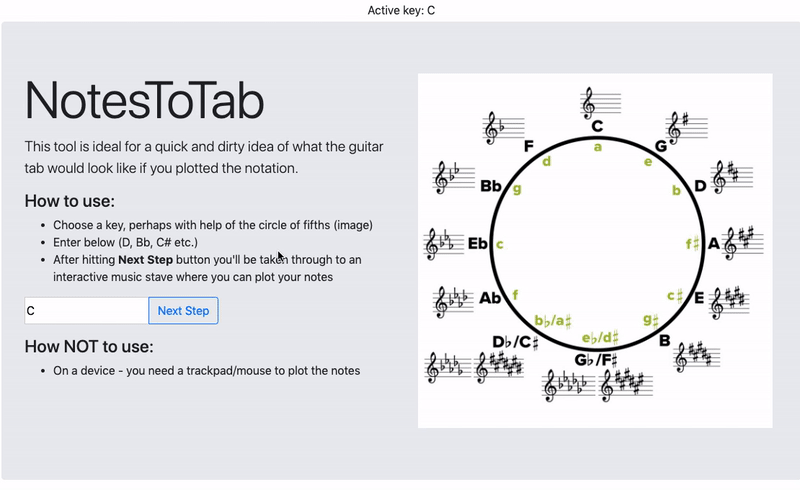

# Notes to Tab

[www.notestotab.com](https://www.notestotab.com/) is a browser tool for manually plotting musical notation and generating guitar tablature. Use a laptop or desktop with a mouse or trackpad; the converter does not import scores or audio.

The application uses Vue 3 single-file components, strict TypeScript and Vite. The homepage's explanatory text and the educational guide are static HTML, available without JavaScript. The interactive converter mounts inside the homepage. The guide has its own Vite HTML entry, so no client router or SPA fallback is needed.

## Development

Use Node 24 (`nvm use`) and npm. The npm lockfile is authoritative; the old Yarn/CRA toolchain has been replaced.

```sh
npm ci
npm start
```

Open http://127.0.0.1:3000/. The guide is at `/sheet-music-to-guitar-tabs/`.

## Verification

```sh
npm run lint
npm run typecheck
npm test
npm run build
npm run check:seo
npm run cypress:CI
```

Vitest runs the retained music-rule fixtures, Vue component tests, canvas tests, storage migration, analytics guards and the S3 upload-plan test. Cypress runs the original startup/key/chord scenarios plus direct-URL, SEO, mobile and engagement checks against the production preview. Browser tests block Google Analytics requests to avoid polluting the live property.

Cypress normally downloads its binary during `npm ci`; if dependencies were installed with `--ignore-scripts`, run `npx cypress install` before browser tests. Install Chrome locally; CI’s Ubuntu runner includes it. `npm run cypress:CI` starts and stops the production preview automatically. For interactive testing, start `npm run preview` separately, then run `npm run cypress:open`.

## Build and hosting

`npm run build` type-checks and writes static files to **build/**, preserving the previous output directory. `npm run preview` serves that build locally. Docker builds with Node 24 and serves the same files with nginx.

GitHub Actions runs lint, tests, the production build, generated-page checks and Chrome browser tests on pull requests and pushes to `master`. Successful pushes to `master` then upload the build to S3 and invalidate CloudFront’s `/*` cache. Runs for the same branch are serialised so deployments cannot overlap.

The upload script validates its region and distribution configuration before writing any objects, and waits for every upload to succeed before requesting invalidation. It includes a literal trailing-slash HTML object for the guide alongside its directory `index.html`, supporting S3 REST origins without a CloudFront rewrite. Alternative upload tools must reproduce this object. Required GitHub secrets are `AWS_ACCESS_KEY_ID`, `AWS_SECRET_ACCESS_KEY` and `AWS_CLOUDFRONT_DIST_ID`. The workflow explicitly sets `AWS_DEFAULT_REGION=eu-west-2` to match the `notate-app` bucket’s London endpoint. For a manual invocation, set the same region; an unrelated default-region secret can cause S3 `PermanentRedirect` errors.

After deployment, verify `/` and `/sheet-music-to-guitar-tabs/` return their correct HTML on direct navigation and refresh, check HTTPS/www redirects and canonical URLs, and confirm the existing GA4 property receives the converter events. Local verification does not change infrastructure or deploy the site.

The existing `userData` local-storage key and historical note shapes remain readable. Existing users may still need to review complex chords; the legacy fingering algorithm and musical limitations are retained.


